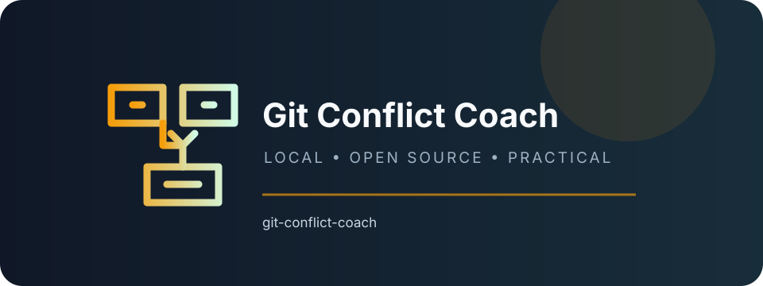

<p align="center"></p>
<p align="center"></p>
<p align="center">   </p>
<p align="center"></p>

## 🧭 Overview
Git Conflict Coach searches local text files for unresolved merge-conflict markers. It shows the block boundaries and line numbers, then optionally writes an HTML report. It never edits or resolves files.

## ✨ Features
- 🔎 Finds start, separator, and end conflict markers.
- 📍 Reports file paths and exact line ranges.
- 🧾 Generates a standalone HTML review report.
- 🛡️ Skips common generated folders and never changes scanned files.

## 🎬 Demo
```text
$ python main.py .
src/config.py:42-48: unresolved conflict block
1 conflict block(s) found.
```
The example runs locally; no hosted service is required.

## 🚀 Quick Start
```bash
python -m pip install -r requirements.txt
python main.py .
```
Use `--html conflicts.html` to create a local report. Binary and non-UTF-8 files are skipped.

## 🧰 Tech Stack
- Python 3.10+
- pathlib, html, and argparse from the standard library
- unittest

## 🗂️ Folder Structure
```text
main.py
conflict_coach.py
tests/test_conflict_coach.py
examples/conflicted.txt
assets/overview.svg
requirements.txt
```

## 🗺️ Roadmap
- [x] Core local workflow
- [x] Documented interface
- [ ] Broader edge-case coverage
- [ ] Optional CI examples

## 🤝 Contributing
Issues and focused pull requests are welcome. Add regression tests for bug fixes and document new behavior.

## 📄 License
Released under the [MIT License](LICENSE).

<p align="center"></p>
